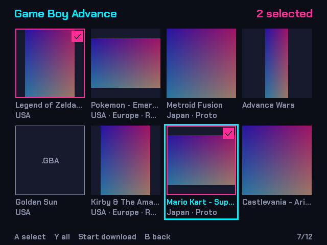
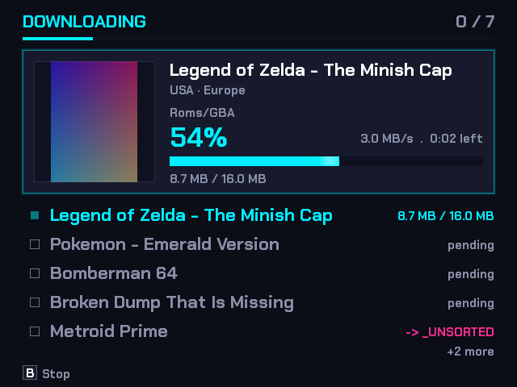

# Install birdROMs on your handheld

For handhelds running **muOS** (Anbernic RG40XX-V, RG35XX+ and similar).

1. **Download.** On your computer, sign in to your friend group's birdROMs website, open **Handheld** and
   download `birdROMs.muxapp`. Don't unzip it. The file already contains the server address.
2. **Copy.** Put the file in the `ARCHIVE` folder (create it if missing) at the top of the SD card, then put
   the card back in the handheld.
3. **Install.** On the handheld: **Applications → Archive Manager → birdROMs → A**.
4. **Open.** **Applications → birdROMs**. It shows a QR code and a short code: scan the QR code with your
   phone and approve. If your phone is not signed in, type the code on the website's **Handheld** page instead.

Pick games with **A**, then **Start** to download. **L1** pages up and **R1** pages down.

To update, download the file again and replace it in `ARCHIVE`, then repeat step 3. You stay signed in.

**Problems?** If the app says "No server configured", download the file again from the website's **Handheld**
page. If the page says the app is not published, ask whoever runs the server.
